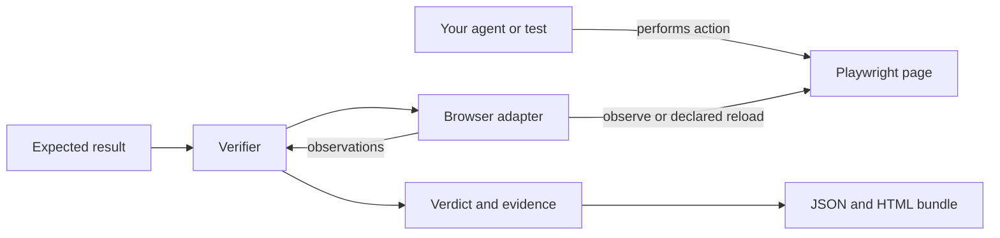

<div align="center">

<h1>BrowserAssert</h1>
<p><strong>Your agent clicked Save. Did the change actually stick?</strong></p>
<p>Check the outcome of a browser action with explicit expectations, bounded waits, and evidence you can inspect.</p>

<p>
  <a href="https://github.com/Balaji91221/browserassert/actions/workflows/ci.yml"></a>
  <a href="https://github.com/Balaji91221/browserassert/blob/main/LICENSE"></a>
  
  
  
</p>

<p><a href="#why-i-built-it">Why</a> · <a href="#quick-start">Quick start</a> · <a href="#usage">Usage</a> · <a href="#architecture">Architecture</a> · <a href="#documentation">Documentation</a></p>
</div>


## Why I built it

As an AI engineer, I want to separate an agent's claim that a task is done from evidence that the application reached the right state. A successful click is useful information, but the setting might still be unsaved, the session might have expired, or the request might have failed.

I built BrowserAssert to make that final check a reusable part of the workflow. The agent performs an action; a small, explicit contract describes the result we expect; BrowserAssert checks the page and returns the observations behind its verdict.

**Example:** an agent changes a display name to `Alice`. BrowserAssert reloads the page when asked, reads the field again, and checks that it still contains `Alice`.

## What it helps you do

| Need | BrowserAssert provides |
|---|---|
| Check that a setting persisted | A declared reload followed by a value check |
| Verify a form submission | Checks against a receipt, status, or other explicit page signal |
| Confirm a download completed | Filename and local file-size checks |
| Debug a failed automation | JSON observations, an HTML report, and optional masked screenshots |
| Handle uncertain outcomes | Separate `verified`, `failed`, and `unknown` results |

Useful for browser-agent builders, Playwright automation authors, and QA engineers. **You own the browser and the action.** BrowserAssert attaches to an existing page.

## Quick start

Requires **Node.js 22.18+**. No model account or API key is needed.

```bash
npm install browserassert
npx browserassert demo
```

The demo checks a simulated edit that disappears after reload. It returns `failed` and intentionally exits with code **1**. For a live browser workflow, clone the example project:

```bash
git clone https://github.com/Balaji91221/browserassert.git
cd browserassert
npm ci
npm run build
npx playwright install chromium
node examples/workflow.mjs /tmp/browserassert-demo-001
```

On Linux, use `npx playwright install --with-deps chromium` to install Chromium
and its required system libraries.

Use a fresh output directory. The example starts a local fixture app, saves a setting, submits a form, and downloads a file. Expected verdicts:

```text
settings: verified
form:     verified
download: verified
```

Open `/tmp/browserassert-demo-001/report.html` to inspect the saved settings check.


*Actual HTML report from the included local fixture. This demonstrates a controlled workflow, not compatibility with every website.*

To see a failure, run `npm run demo`. It simulates a value that disappears after reload and intentionally exits with code **1**.

## Usage

### Install the SDK in your application

```bash
npm install browserassert
# If your app does not already use Playwright:
npm install playwright
npx playwright install chromium
```

The package includes compiled JavaScript and TypeScript declarations. It uses the Playwright page supplied by your application.

### Verify a result on an existing Playwright page

```ts
import { PlaywrightAdapter, verify } from 'browserassert';

// `page` is your existing Playwright Page, after your agent saves the setting.
const result = await verify(
  { selector: '#display-name', expected: 'Alice', reload: true, timeoutMs: 3000 },
  new PlaywrightAdapter(page),
);

console.log(result.verdict);
console.log(result.evidence);
```

The selector must identify exactly one element. `reload: true` permits a page reload; omit it for observation-only checks. The verifier never clicks Save or repeats the original action.

| Verdict | Meaning |
|---|---|
| `verified` | The requested value was observed within the deadline |
| `failed` | Completed observations did not satisfy the contract |
| `unknown` | Evidence was incomplete, unavailable, cancelled, or still pending at the deadline |

Use the **SDK for live browser checks** and the **CLI for recorded observations and reports**. There is no MCP server in this release. See the [usage guide](https://github.com/Balaji91221/browserassert/blob/main/docs/usage.md) for verification plans, authentication signals, downloads, redaction, and cancellation.

## Architecture



The verifier owns the decision rules. The adapter reads browser state. The reporting layer turns observations into shareable artifacts.

| Component | Responsibility |
|---|---|
| [`verify` / `BrowserAdapter`](https://github.com/Balaji91221/browserassert/blob/main/src/index.ts) | Validate a contract, poll within a deadline, and classify the evidence |
| [`PlaywrightAdapter`](https://github.com/Balaji91221/browserassert/blob/main/src/index.ts) | Read a single matching element and perform a requested reload |
| [`runPlan`](https://github.com/Balaji91221/browserassert/blob/main/src/plan.ts) | Run multiple checks under one overall deadline and optional authentication gate |
| [`saveBundle`](https://github.com/Balaji91221/browserassert/blob/main/src/plan.ts) | Save redacted JSON, an HTML report, optional screenshot, and file hashes |
| [`CLI`](https://github.com/Balaji91221/browserassert/blob/main/src/cli.ts) | Evaluate recordings and generate reports |

Read the [architecture guide](https://github.com/Balaji91221/browserassert/blob/main/docs/architecture.md) for the HLD, LLD, contracts, and design tradeoffs.

## Current scope

- Checks are deterministic. No LLM decides whether an outcome is verified.
- A page signal must be chosen for your application; authentication detection is not universal.
- Download checks cover completion, filename, and size, not the meaning of the contents.
- Screenshots are opt-in. Configure redaction and masking for sensitive data before sharing evidence.

## Documentation

| Start here | Go deeper |
|---|---|
| [Usage and integration recipes](https://github.com/Balaji91221/browserassert/blob/main/docs/usage.md) | [Architecture: HLD and LLD](https://github.com/Balaji91221/browserassert/blob/main/docs/architecture.md) |
| [Implemented features](https://github.com/Balaji91221/browserassert/blob/main/FEATURE_MATRIX.md) | [Project plan](https://github.com/Balaji91221/browserassert/blob/main/PROJECT_PLAN.md) |
| [Verification and release scope](https://github.com/Balaji91221/browserassert/blob/main/IMPLEMENTATION_STATUS.md) | [Security policy](https://github.com/Balaji91221/browserassert/blob/main/SECURITY.md) |

## Development

```bash
npm run typecheck
npm run build
npm test
```

The test suite includes real-browser integration checks; install Chromium as shown above. See [CONTRIBUTING.md](https://github.com/Balaji91221/browserassert/blob/main/CONTRIBUTING.md) for the workflow, or open a [GitHub issue](https://github.com/Balaji91221/browserassert/issues) with a reproducible case.

Released under the [MIT License](https://github.com/Balaji91221/browserassert/blob/main/LICENSE).
