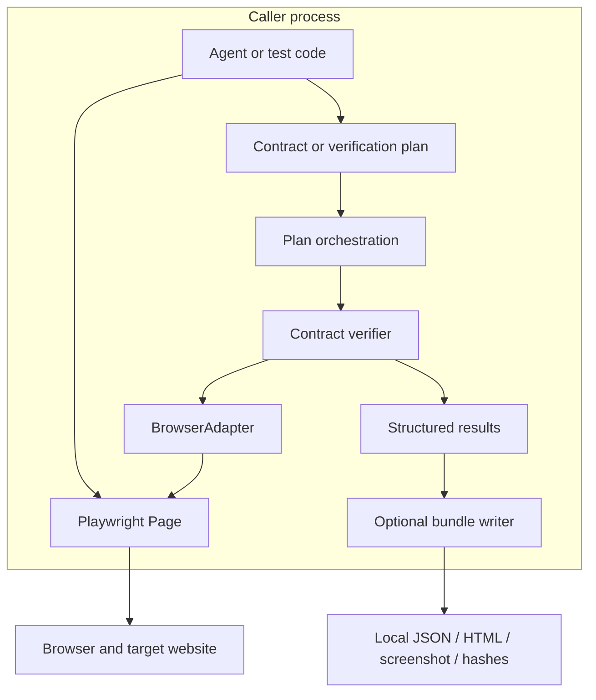

# BrowserAssert architecture

[← README](../README.md) · [Usage guide](usage.md)

BrowserAssert verifies a declared browser outcome. It does not own the agent's action or the browser session. This guide describes the implemented 0.2.0 design.

## High-level design

The library runs inside the caller's Node.js process. The caller owns a Playwright page, performs an action, and supplies a contract. BrowserAssert observes the page through an adapter and returns a verdict with its evidence. Saving a report is a separate, explicit operation.



There is no hosted backend, queue, database, MCP server, or model call in this design. The CLI evaluates recorded observations; live browser access uses the SDK.

## Low-level design

| Owner | Public contract | Why it is separate |
|---|---|---|
| [`src/index.ts`](../src/index.ts) | `verify(contract, adapter, { signal? })` | Owns validation, comparison, polling, and verdicts |
| [`BrowserAdapter`](../src/index.ts) | `observe(selector, signal)`; optional `reload(signal)` | Makes browser access replaceable without changing verdict logic |
| [`PlaywrightAdapter`](../src/index.ts) | Wraps a caller-owned page | Enforces exactly one matching element and identifies observation source |
| [`src/plan.ts`](../src/plan.ts) | `runPlan(plan, adapter, { signal? })` | Shares a deadline across checks and an optional authentication gate |
| [`src/plan.ts`](../src/plan.ts) | `saveBundle(directory, plan, result, options)` | Owns redaction and explicit local artifact writes |
| [`src/cli.ts`](../src/cli.ts) | Recording checks and HTML report commands | Keeps command parsing outside the verification algorithm |
| [`src/fixture.ts`](../src/fixture.ts) | Controlled local test application | Makes persistence failures, expired sessions, and downloads reproducible |

### Core data

```ts
type Observation = { value: unknown; source: string };
type VerificationResult = {
  verdict: 'verified' | 'failed' | 'unknown';
  reason: string;
  evidence: Observation[];
};
```

A `Contract` declares a selector and expected scalar value, with optional comparison operator, reload permission, timeout, and polling interval. A `VerificationPlan` adds an ID, multiple named checks, an overall timeout, and an optional authentication observation. See the [plan schema](../schemas/plan.schema.json); runtime validation also checks cross-field constraints.

## Request flow: did a setting persist?

1. The caller fills the field and clicks Save using its own automation code.
2. It calls `verify` with `reload: true` and the expected saved value.
3. The verifier validates the contract and establishes an absolute deadline.
4. The adapter reloads, then reads the single element matching the selector.
5. The verifier checks the observation's source and compares its value with the expectation. It polls within the remaining budget when necessary.
6. The caller receives a verdict and observations. It may save a report or choose a recovery action.

The verifier does not repeat the save operation. This avoids turning an observation failure into a second side effect.

## Invariants and failure behavior

| Situation | Result |
|---|---|
| Expected value observed before the deadline | `verified` |
| Completed mismatching observations exhaust the polling window | `failed` |
| An observation is still pending at the deadline | `unknown` |
| Caller cancels, selector is ambiguous, or adapter fails | `unknown` |
| Authentication gate is not verified | Plan is `unknown`; protected checks do not run |
| Any plan check is unknown | Overall plan is `unknown`, even if another check failed |
| Observation arrives after its deadline | It cannot turn the result into `verified` |

Adapters receive an `AbortSignal` and must cooperate with cancellation. A timeout stops waiting; it cannot forcibly terminate arbitrary caller code. The Playwright adapter reads a DOM element's value or text; a numeric contract still requires numeric evidence from an appropriate adapter.

## State and evidence

Checks accumulate observations in memory. Bundle writing creates a fresh directory and refuses an existing target. The bundle contains plan/result JSON, an HTML report, an optional screenshot, and SHA-256 file hashes.

Redaction covers only configured selectors and values. Screenshot masking is explicitly configured; it cannot automatically find secret pixels. Hashes help detect changed files, but are not signatures or proof that the source browser was trustworthy.

## Design decisions

- **Composition over a browser framework:** the caller supplies an adapter and owns browser lifecycle. This fits existing agents and test suites.
- **Small adapter interface:** most verifiers need observation; reload support is optional and must be declared by the contract.
- **One decision owner:** adapters return observations. They do not invent their own success policy.
- **Explicit uncertainty:** missing evidence remains unknown instead of becoming a successful task completion.
- **Separate reporting:** file writes and redaction can evolve independently of contract evaluation.

These boundaries apply single responsibility, interface segregation, and dependency inversion in concrete places. An adapter is substitutable only when it preserves source identity, observes the requested selector, and honors cancellation as far as its underlying browser API permits.

## Where the LLM fits

An LLM-driven agent can be the caller, but the verification path contains no model. A model may suggest which result to check; the application still needs to choose and validate that contract. BrowserAssert checks only the stated condition, not the full meaning of a user's goal.

## Verification

The [tests](../test) exercise core predicates, timing and cancellation, plan behavior, evidence redaction, and real Playwright workflows. Run `npm run typecheck`, `npm run build`, and `npm test` from the repository root after installing the browser. See the [security policy](../SECURITY.md) before sharing evidence.
